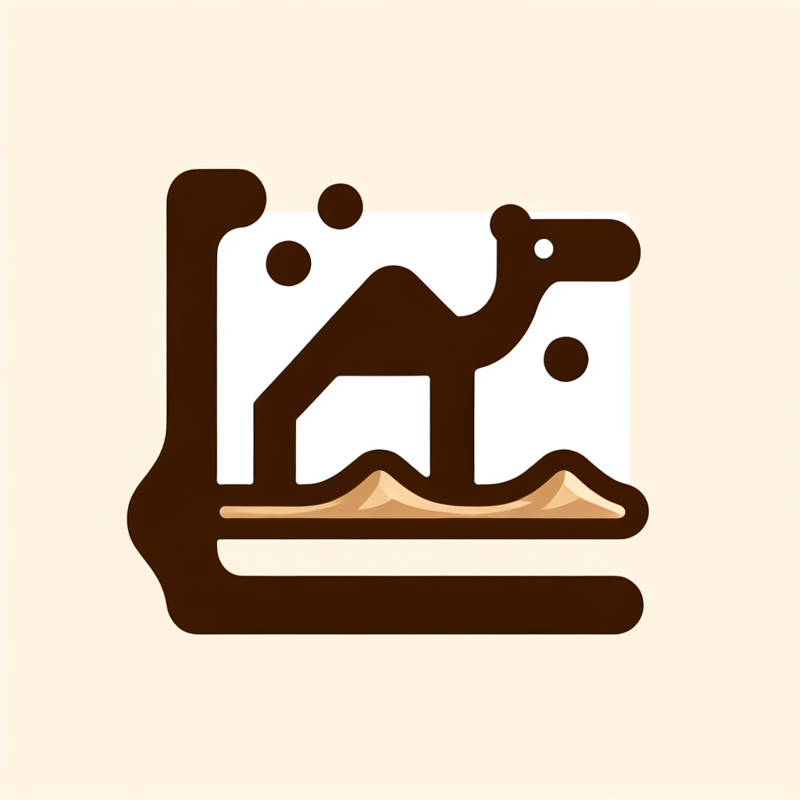
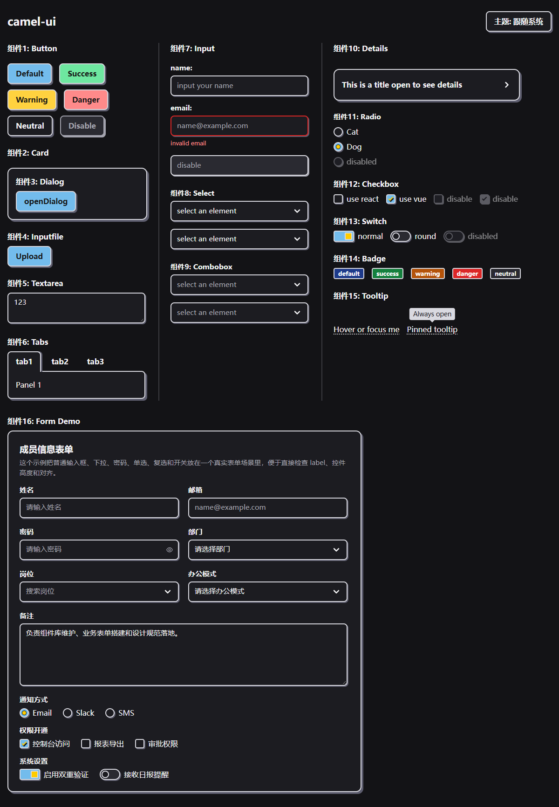

# camel-ui


# 样式预览
浅色（默认，也可通过 `<html data-theme="light">` 强制）：


深色（跟随系统，或 `<html data-theme="dark">`）：




# 使用方法
安装
```bash
$ npm i @sunwu51/camel-ui
```
参考`App.tsx`中每个组件的使用方法，基本都非常简单，每个组件1-3行代码。
# 布局与间距
组件的硬阴影画在元素外面(静止 2px, 聚焦最多 4px), 不占布局空间, 组件自身也不带外边距。这样输入框和按钮放在一行时能精确对齐, 但紧挨在控件下方的内容会被阴影压到。约定:

- 带阴影的控件和下方内容至少间隔 `var(--shadow-space)`(8px)。
- 输入框下方的提示文字优先用 `Input` 的 `description` / `errorMessage`, 它们在组件内部, 已留好间距。
- 一张卡片里纵向排一串控件时, 用 `<Card stack>`: 子元素之间自动留出 `--shadow-space`, 不改变子元素宽度。

# 组件列表
- badge
- button
- card
- checkbox
- combobox
- details
- dialog
- input
- input file
- radio
- select
- switch
- table
- tabs
- textarea
- tooltip
